# Weather Data Pipeline

**An end-to-end Data Engineering project built with Python, AWS S3, PostgreSQL, dbt, Apache Airflow, and Docker.**

## Project Overview

This project implements a batch data pipeline that extracts, stores, transforms, and validates hourly weather data for 10 Spanish cities.

The goal is to demonstrate a complete Data Engineering workflow, from API ingestion to an analytics-ready dataset, using a reproducible Docker-based environment.

### How It Works

1. **Extract:** Python retrieves weather data from Open-Meteo.
2. **Store:** Raw JSON files are preserved locally and uploaded to Amazon S3.
3. **Load:** Weather observations are loaded into PostgreSQL using idempotent upserts.
4. **Transform:** dbt builds staging, intermediate, and analytical models.
5. **Validate:** dbt tests and Python unit tests check data quality.
6. **Orchestrate:** Apache Airflow manages task dependencies, automatic retries, and daily scheduling.

### Key Features

- Automated daily batch pipeline.
- Idempotent data ingestion.
- Date- and city-partitioned raw storage.
- Reusable SQL transformations with dbt.
- Automated data quality checks and error handling.
- Docker-first architecture.
- End-to-end validation and database initialization tests.

### Current Scope

The pipeline currently processes 10 Spanish cities and runs in a local Docker environment with AWS S3 as its cloud storage layer.

Planned extensions include a nationwide interactive weather dashboard and additional analytical use cases.

**Project status:** Initial pipeline implemented and validated. Local development setup; not intended as an unattended production deployment.


## Architecture

The pipeline follows a batch-oriented ELT architecture. Apache Airflow orchestrates data extraction, ingestion, transformation, and quality validation.

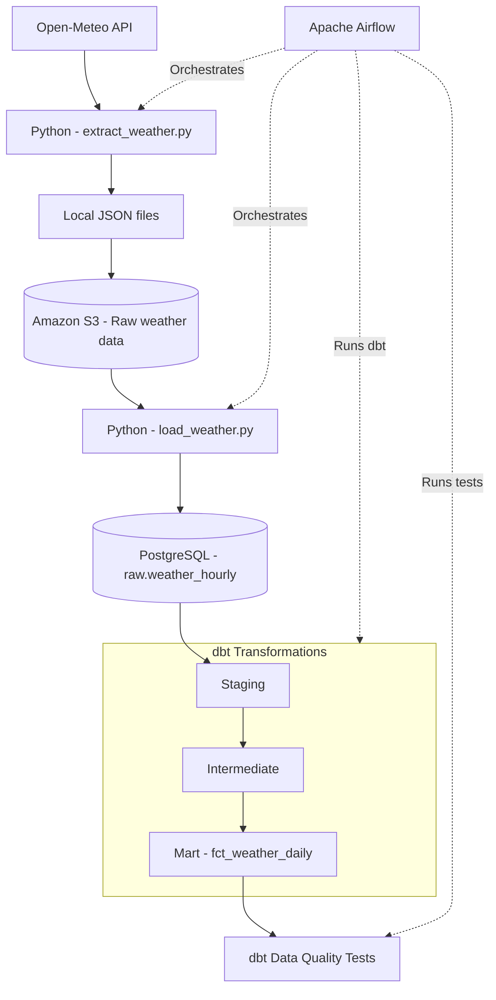


## Quick Start — Windows

This guide explains how to set up the Weather Data Pipeline on a Windows machine using Docker Desktop and AWS.

### Prerequisites

- Windows with Docker Desktop (WSL2 enabled)
- Git
- AWS CLI v2 with `aws login` support
- An AWS account with permissions to use Amazon S3

The Python, PostgreSQL, dbt, and Airflow dependencies run inside Docker containers.

### 1. Clone the Repository

```powershell
git clone https://github.com/NoelMerida12/weather-data-pipeline.git
cd weather-data-pipeline
```

### 2. Configure Environment Variables

Create a local environment file:

```powershell
Copy-Item .env.example .env
```

Edit `.env` and configure the PostgreSQL and pgAdmin passwords, AWS profile, AWS Region, and S3 bucket name.

Do not commit `.env` to version control.

### 3. Authenticate with AWS

This project uses temporary AWS credentials instead of permanent access keys.

```powershell
aws login --profile weather-pipeline
```

Verify authentication:

```powershell
aws sts get-caller-identity --profile weather-pipeline
```

The AWS profile and local login directory must be available before starting Docker.

### 4. Configure Amazon S3

Create a private S3 bucket in `eu-west-1` using the AWS Console, or use an existing bucket with suitable permissions.

If creating a new bucket, choose a globally unique name and set the same name in `.env` under `S3_BUCKET_NAME`.

AWS resources may incur charges depending on usage and account limits.

### 5. Start Docker Services

```powershell
docker compose up -d --build
```

Check the container status:

```powershell
docker compose ps
```

Services:

| Service | Local URL |
|---|---|
| Airflow | http://localhost:8080 |
| pgAdmin | http://localhost:5050 |
| PostgreSQL | localhost:5432 |

The PostgreSQL initialization script automatically creates the raw schema and weather table when the database is initialized with an empty volume.

### 6. Execute the Pipeline

Open Airflow at http://localhost:8080 and locate the `weather_pipeline` DAG.

Trigger a manual execution and verify that these four tasks succeed:

```text
extract_weather
    ↓
load_weather
    ↓
dbt_run
    ↓
dbt_test
```

The DAG is also configured for daily execution at 02:00 UTC while the local environment is running.

### 7. Run Automated Tests

Execute the Python tests:

```powershell
docker compose exec airflow python /opt/airflow/scripts/test_error_handling.py
```

Execute dbt quality tests:

```powershell
docker compose exec airflow dbt test --project-dir /opt/airflow/dbt --profiles-dir /opt/airflow/dbt
```

### Important Notes

This configuration is designed for Windows because the Docker Compose file mounts AWS authentication files using `${USERPROFILE}`.

AWS login sessions expire and may require renewed authentication. Daily scheduled execution requires Docker and Airflow to remain running.

A fresh PostgreSQL initialization has been tested independently, but the entire application has not yet been validated through a clean-clone deployment.

## Local Architecture

The project uses Docker Compose to provide a reproducible local development environment.

All Python dependencies, PostgreSQL, dbt, and Apache Airflow run inside Docker containers. The Windows host only requires Docker Desktop, Git, and AWS CLI. VS Code is recommended for development.

### Docker Services

| Service | Technology | Purpose |
|---|---|---|
| `postgres` | PostgreSQL 17 | Stores weather observations and Airflow metadata |
| `airflow` | Apache Airflow 3.3.2 | Orchestrates the pipeline and executes Python scripts and dbt |
| `pgadmin` | pgAdmin 4 | Provides a graphical interface for PostgreSQL |

The Airflow Docker image includes Python 3.12, dbt Core, dbt-postgres, requests, boto3, and the PostgreSQL Python driver.

### Storage and Networking

- Docker named volumes preserve PostgreSQL data, pgAdmin configuration, and Airflow logs.
- Bind mounts expose project scripts, DAGs, dbt models, and local raw data to the Airflow container.
- PostgreSQL, Airflow, and pgAdmin are accessible from the Windows host through localhost.
- AWS authentication uses temporary credentials mounted from the Windows host.

This setup is designed for local development rather than production deployment.


## Data ingestion

Weather data is extracted from the Open-Meteo API using Python and the `requests` library.

The pipeline currently processes the following Spanish cities:

- Barcelona
- Madrid
- Valencia
- Sevilla
- Bilbao
- Malaga
- Zaragoza
- Murcia
- Palma
- Alicante

City coordinates are resolved dynamically using the Open-Meteo Geocoding API. This avoids hardcoding latitude and longitude values in the project and makes it easier to add new cities later.

The ingestion process follows this flow:

```text
City name
    ↓
Open-Meteo Geocoding API
    ↓
Latitude / Longitude
    ↓
Open-Meteo Weather API
    ↓
Hourly weather data
    ↓
Raw JSON
```

### Weather variables

For each city, the pipeline retrieves the following hourly variables:

- Temperature at 2 metres
- Relative humidity at 2 metres
- Precipitation
- Wind speed at 10 metres

The pipeline retrieves data for the previous complete day.

All timestamps are requested in UTC to keep the time representation consistent across the pipeline and avoid issues related to local time zones or daylight-saving changes.

### Raw data storage

The raw API response is preserved as JSON before any transformation is applied.

Files are stored using a date and city partition structure:

```text
data/
└── raw/
    └── weather/
        └── date=YYYY-MM-DD/
            ├── city=barcelona/
            │   └── weather.json
            ├── city=madrid/
            │   └── weather.json
            ├── city=valencia/
            │   └── weather.json
            └── ...
```

For example:

```text
data/raw/weather/date=2026-10-25/city=barcelona/weather.json
```

The `data/raw/` directory is excluded from Git because these files are generated by pipeline executions rather than being part of the source code.

### Why keep raw data?

Keeping the original API response allows the pipeline to reprocess data later without calling the source API again.

This also separates ingestion from downstream transformation logic:

```text
Source API
    ↓
Raw data
    ↓
Transformation
    ↓
Analytical data
```

Raw weather data is saved locally and uploaded to Amazon S3 using Boto3.

### Idempotency

The extraction process uses deterministic paths based on the processing date and city.

For example:

```text
date=2026-10-25/city=barcelona/weather.json
```

Running the extraction multiple times for the same date and city overwrites the same file instead of creating duplicates.

This provides a basic form of pipeline idempotency and makes retries safer.

### Error handling

The ingestion script includes basic error handling:

- HTTP requests use a timeout to prevent connections from waiting indefinitely.
- `raise_for_status()` stops execution when an API request returns an HTTP error.
- Geocoding results are validated before coordinates are used.
- Weather responses are checked to ensure hourly data is present.
- Existing output directories can be reused without causing errors.

Apache Airflow manages task retries automatically, with two retries and a five-minute delay between attempts.

### Running the ingestion

The Python runtime and its dependencies are installed inside the custom Airflow Docker image.

No Python dependencies need to be installed directly on the Windows host.

From the project root:

```text
D:\projects\weather-data-pipeline
```

run:

```powershell
docker compose exec airflow python /opt/airflow/scripts/extract_weather.py
```

The script:

1. Calculates the previous day in UTC.
2. Iterates through the configured cities.
3. Resolves coordinates using the Geocoding API.
4. Retrieves hourly weather data.
5. Creates the corresponding raw directory.
6. Stores the original API response as `weather.json`.

### Verify generated files

From the project root:

```powershell
Get-ChildItem .\data\raw\weather -Recurse -Filter weather.json
```

To count the generated JSON files:

```powershell
(Get-ChildItem .\data\raw\weather -Recurse -Filter weather.json).Count
```

With the current configuration, the expected result is:

```text
10
```

Running the ingestion again for the same date should still return:

```text
10
```

rather than `20`, because the same files are overwritten.

### Current ingestion architecture

```text
                    Open-Meteo
                        │
                        │
              ┌─────────▼──────────┐
              │   Geocoding API    │
              │                    │
              │ City → coordinates │
              └─────────┬──────────┘
                        │
                        ▼
              ┌────────────────────┐
              │    Weather API     │
              │                    │
              │ Hourly weather     │
              └─────────┬──────────┘
                        │
                        ▼
              ┌────────────────────┐
              │       Python       │
              │                    │
              │ extract_weather.py │
              └─────────┬──────────┘
                        │
                        ▼
              ┌────────────────────┐
              │     Raw JSON       │
              │                    │
              │ date + city        │
              └────────────────────┘

All Python code is executed inside the custom Airflow Docker container.
```

### Technical decisions

The main technical decisions made during this phase are:

- **Dynamic geocoding instead of hardcoded coordinates:** city coordinates are retrieved using the Open-Meteo Geocoding API.
- **Configuration-driven cities:** the ingestion logic is reusable and new cities can be added to the `CITIES` list without changing the extraction logic.
- **UTC timestamps:** keeps time handling consistent across the pipeline.
- **Previous complete day:** avoids processing partially completed days.
- **Raw JSON preservation:** keeps the source response available for future reprocessing.
- **Date and city partitioning:** creates a predictable raw-data structure that can later be reproduced in S3.
- **Deterministic filenames:** helps make the extraction idempotent.
- **HTTP timeout:** prevents requests from remaining open indefinitely.
- **Explicit HTTP error handling:** failed API responses stop the pipeline instead of being silently accepted.
- **Docker-first execution:** Python and its dependencies run inside the Airflow image rather than on the host machine.

### Extraction Phase Outcome

The extraction component retrieves hourly weather data and stores partitioned JSON files locally.

Subsequent development phases added Amazon S3 storage, PostgreSQL ingestion, dbt transformations, and Apache Airflow orchestration.

The complete pipeline is now implemented and validated.

### Data source

Weather and geocoding data are provided by Open-Meteo.


### Example raw data partitions

After running the ingestion pipeline, one directory is created for each configured city:

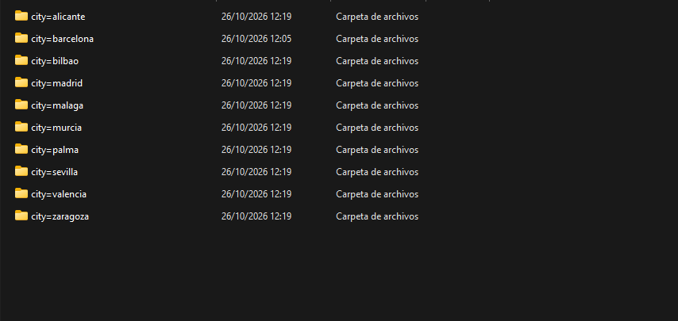


## AWS S3 Raw Storage

The pipeline now uploads the raw weather JSON files to Amazon S3 after saving them locally.

### AWS authentication

AWS access is configured using a dedicated IAM user:

- `weather-pipeline-dev`
- MFA enabled
- No permanent access keys are stored in the project
- Authentication is performed using `aws login`
- Temporary AWS credentials are reused inside the Airflow container through a bind mount

The AWS configuration is mounted from the Windows host into the Airflow container:

```text
Windows host
~/.aws/config
~/.aws/login
        |
        v
Airflow container
/home/airflow/.aws/
```

This allows Boto3 to authenticate with AWS without storing AWS secrets in `.env` or GitHub.

### S3 bucket

Raw weather data is stored in:

```text
s3://weather-data-pipeline-noel-2026-1027/
```

The bucket is located in:

```text
eu-west-1
```

The bucket remains private and S3 Block Public Access is enabled.

### S3 partition structure

The same partition structure used locally is preserved in S3:

```text
raw/
└── weather/
    └── date=YYYY-MM-DD/
        ├── city=alicante/
        │   └── weather.json
        ├── city=barcelona/
        │   └── weather.json
        ├── city=bilbao/
        │   └── weather.json
        ├── city=madrid/
        │   └── weather.json
        ├── city=malaga/
        │   └── weather.json
        ├── city=murcia/
        │   └── weather.json
        ├── city=palma/
        │   └── weather.json
        ├── city=sevilla/
        │   └── weather.json
        ├── city=valencia/
        │   └── weather.json
        └── city=zaragoza/
            └── weather.json
```

### Upload process

The Python extraction script uses Boto3 to upload each generated JSON file to S3.

The flow is now:

```text
Open-Meteo
    |
    v
Python extraction
    |
    v
Local raw JSON
    |
    v
Boto3
    |
    v
Amazon S3 raw layer
```

The S3 object key is generated dynamically:

```text
raw/weather/date=<date>/city=<city>/weather.json
```

### Idempotency

The pipeline was executed multiple times for the same date.

Each city always uses the same deterministic S3 object key, so running the pipeline again replaces the existing object instead of creating duplicates.

Expected result:

```text
First run  -> 10 objects
Second run -> 10 objects
```

This makes the raw ingestion step idempotent for the same city and date.

### Running the pipeline

```powershell
docker compose exec airflow python /opt/airflow/scripts/extract_weather.py
```

### Verify S3 objects

```powershell
aws s3 ls s3://weather-data-pipeline-noel-2026-1027/raw/weather/date=YYYY-MM-DD/ --recursive --profile weather-pipeline
```

### Screenshot

The S3 raw data partition structure can be seen below:

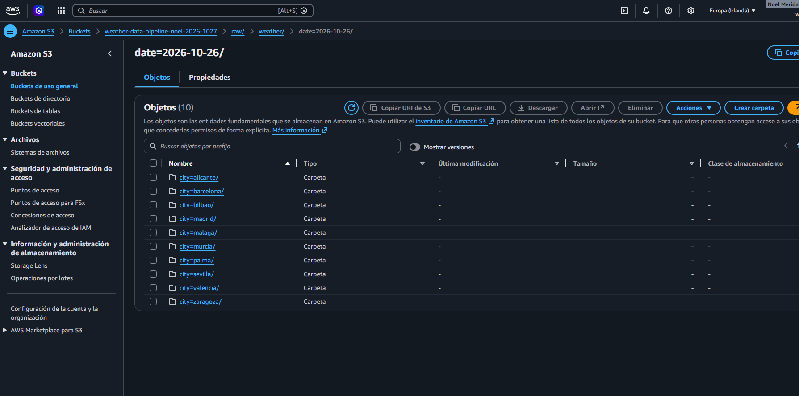

### Technical decisions

- Amazon S3 is used as the cloud raw storage layer.
- Raw API responses are preserved as JSON.
- Data is partitioned by date and city.
- Boto3 is used for programmatic uploads.
- AWS authentication uses temporary credentials instead of long-lived access keys.
- AWS configuration is mounted into the Airflow container.
- AWS secrets are never stored in the repository.
- The S3 bucket remains private.
- Re-running the extraction for the same date does not create duplicate objects.


## PostgreSQL and dbt Transformations

In this phase, raw weather data stored in Amazon S3 is loaded into PostgreSQL and transformed using dbt Core.

### Data pipeline

```text
Amazon S3 (raw JSON)
        |
        v
Python + Boto3 + psycopg2
        |
        v
PostgreSQL: raw.weather_hourly
        |
        v
dbt Staging: stg_weather_hourly
        |
        v
dbt Intermediate: int_weather_daily
        |
        v
dbt Marts: fct_weather_daily
```

### PostgreSQL ingestion

The `scripts/load_weather.py` script reads raw weather JSON files from S3, converts hourly arrays into database records, and loads them into PostgreSQL.

The raw table uses `(city, observed_at)` as a composite primary key.

Data loading uses `INSERT ... ON CONFLICT DO UPDATE` to prevent duplicate records when the pipeline is executed multiple times.

The initial validation included 480 hourly records across 10 Spanish cities and two dates.

### dbt models

The dbt project is organized into three transformation layers.

| Layer | Model | Purpose |
|---|---|---|
| Staging | `stg_weather_hourly` | Standardizes column names and creates a UTC weather date |
| Intermediate | `int_weather_daily` | Calculates daily weather metrics using SQL aggregations |
| Marts | `fct_weather_daily` | Creates the final analytical table with weather classifications and completeness indicators |

The final mart contains daily temperature, humidity, precipitation, wind speed, and completeness metrics.

The staging and intermediate models use views, while the final mart is materialized as a PostgreSQL table.

### Data quality tests

Four dbt tests were implemented:

- `not_null` on `city`
- `not_null` on `weather_date`
- `assert_unique_city_date` to detect duplicate city/date combinations
- `assert_complete_day` to check for 24 hourly records per city and day

All four tests passed during validation.

### Running the pipeline

First, extract and upload weather data to S3:

```powershell
docker compose exec airflow python /opt/airflow/scripts/extract_weather.py
```

Then load the data into PostgreSQL:

```powershell
docker compose exec airflow python /opt/airflow/scripts/load_weather.py
```

Run all dbt models:

```powershell
docker compose exec airflow dbt run --project-dir /opt/airflow/dbt --profiles-dir /opt/airflow/dbt
```

Run the data quality tests:

```powershell
docker compose exec airflow dbt test --project-dir /opt/airflow/dbt --profiles-dir /opt/airflow/dbt
```

### Validation screenshots

**Final weather mart**

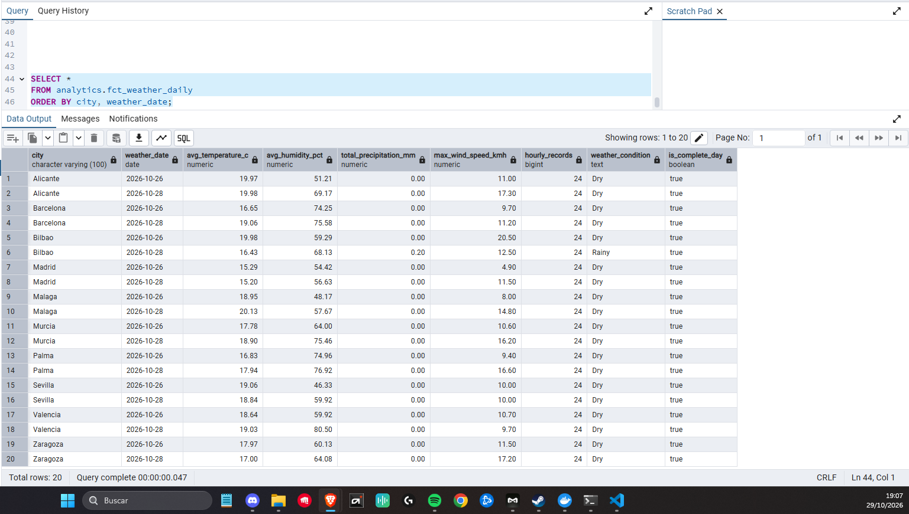

**dbt data quality tests**

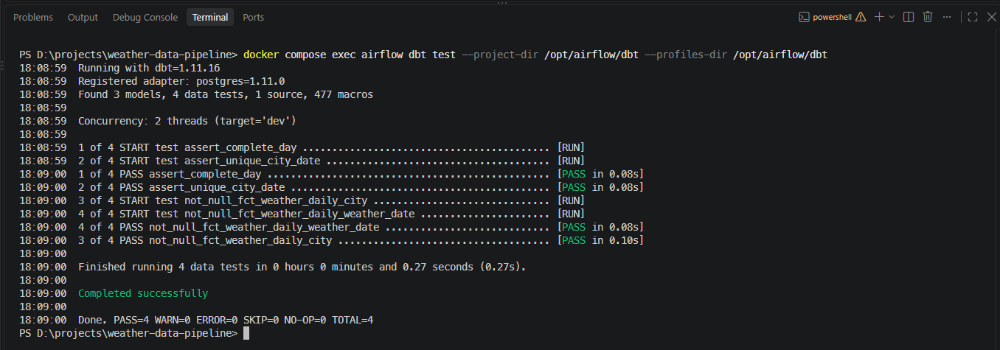

### Technical decisions

- PostgreSQL stores hourly weather observations.
- Python and psycopg2 handle the S3-to-PostgreSQL ingestion.
- Upserts prevent duplicate city/hour combinations.
- dbt separates transformations into reusable SQL models.
- `source()` references the original PostgreSQL table.
- `ref()` defines dependencies between dbt models.
- The final mart is materialized as a table for analytical consumption.
- Data quality tests validate essential business rules.


## Apache Airflow Orchestration

In this phase, Apache Airflow was introduced to orchestrate the complete weather data pipeline.

Previously, extraction, loading, and dbt transformations were executed manually. Airflow now manages task execution, dependencies, retries, and scheduling.

### DAG Architecture

The DAG is defined in `dags/weather_pipeline_dag.py` and contains four tasks:

```text
extract_weather
      |
      v
load_weather
      |
      v
dbt_run
      |
      v
dbt_test
```

| Task | Description |
|---|---|
| `extract_weather` | Extracts hourly weather data from Open-Meteo and uploads JSON files to Amazon S3 |
| `load_weather` | Reads JSON files from S3 and upserts weather records into PostgreSQL |
| `dbt_run` | Executes staging, intermediate, and marts transformations |
| `dbt_test` | Runs dbt data quality tests |

Task dependencies ensure that downstream tasks only execute after upstream tasks succeed.

### Task Retries

Automatic retries are configured:

- Maximum retries: 2
- Retry delay: 5 minutes
- Maximum attempts per task: 3

This helps the pipeline recover from temporary failures, such as API connectivity issues.

### Consistent Processing Date

Airflow passes the `WEATHER_TARGET_DATE` environment variable to both extraction and loading tasks.

The processing date is calculated from the DAG run's scheduled execution time in UTC.

This ensures that both tasks process the same date, even if execution is delayed or a task is retried.

When executed manually, the DAG also uses the previous UTC day relative to the run time.

### Daily Scheduling

The DAG uses the following Cron expression:

```python
schedule="0 2 * * *"
```

This schedules the pipeline daily at 02:00 UTC.

The DAG also uses:

```python
catchup=False
```

This prevents automatic creation of historical scheduled runs that were missed before the DAG was enabled.

### Running the Pipeline

Start the Docker environment:

```powershell
docker compose up -d
```

Authenticate with AWS when required:

```powershell
aws login --profile weather-pipeline
```

Open the Airflow interface:

http://localhost:8080

Select `weather_pipeline` to inspect the DAG, trigger a manual run, review task status, and examine execution logs.

### Validation

The complete DAG was successfully executed from the Airflow interface.

All four tasks completed successfully:

- Weather data was extracted and uploaded to S3.
- Weather records were loaded into PostgreSQL.
- All three dbt models executed successfully.
- All four dbt data quality tests passed.

Airflow logs also confirmed that the extraction processed the expected UTC date and uploaded files for all 10 cities.

### Screenshots

**Successful DAG execution**

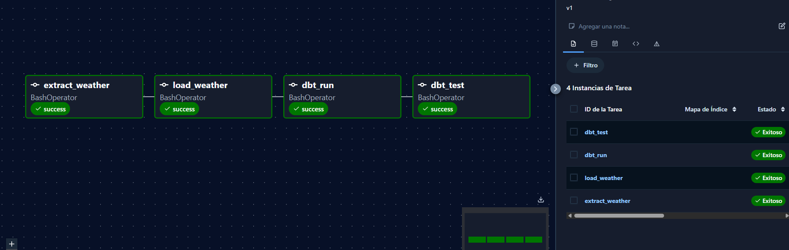

**Weather extraction logs**

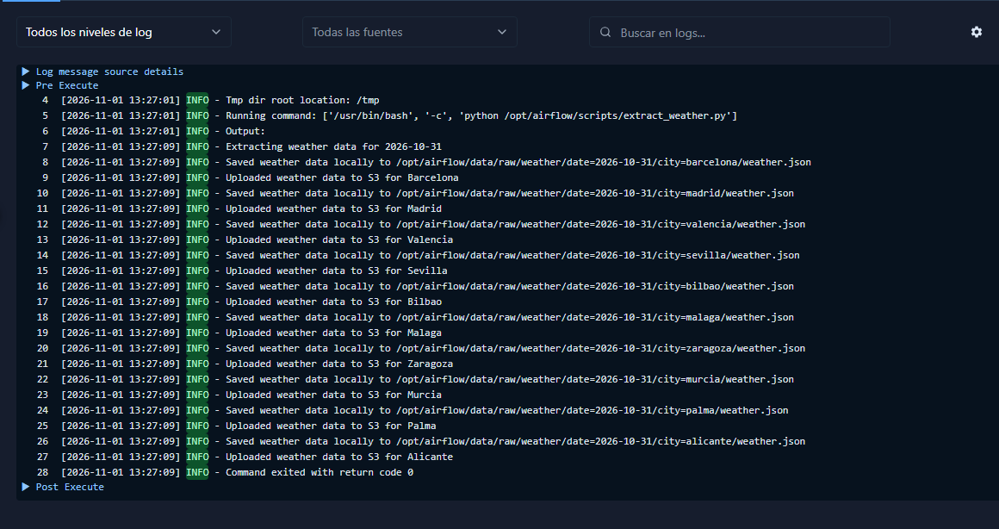

**Daily DAG scheduling**

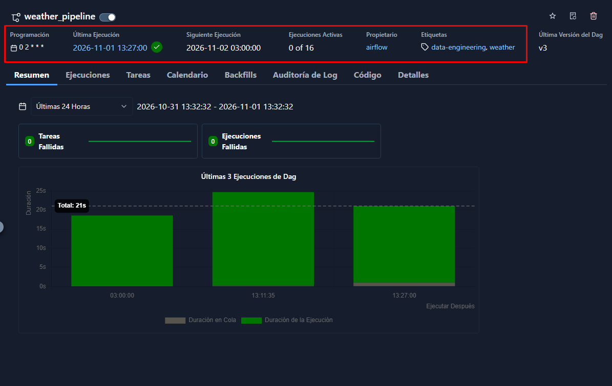

### Technical Decisions

- Airflow 3 is used for workflow orchestration.
- `BashOperator` executes the existing Python scripts and dbt commands.
- `LocalExecutor` is used for the local Docker environment.
- Task dependencies prevent premature downstream execution.
- Automatic retries improve resilience to transient errors.
- A shared processing date maintains consistency between extraction and loading.
- Docker provides a reproducible development environment.

### Current Limitations

- The pipeline runs only while Docker and Airflow are running.
- AWS authentication uses temporary `aws login` credentials that require renewal.
- The current setup is intended for local development and learning, not unattended production workloads.

Future improvements could include production-grade AWS authentication, monitoring, alerting, and more robust recovery mechanisms.

##  End-to-End Validation and Reproducibility

### Overview

This phase focuses on validating the complete weather data pipeline, verifying data consistency, testing persistence, and improving database initialization for reproducibility.

### 1. End-to-End Pipeline Validation

The complete pipeline was executed successfully through Apache Airflow.

**Data flow:**

```text
Open-Meteo API
      |
      v
Amazon S3 (Raw JSON)
      |
      v
PostgreSQL (raw.weather_hourly)
      |
      v
dbt (Staging → Intermediate → Marts)
      |
      v
analytics.fct_weather_daily
```

Validation results for October 31, 2026:

| Check | Result |
|---|---|
| Cities processed | 10 |
| S3 JSON files | 10 |
| PostgreSQL hourly records | 240 |
| Daily analytical records | 10 |
| Complete city-days | 10 |
| Airflow task execution | Successful |

### 2. Idempotency Testing

The Airflow DAG was executed multiple times for the same processing date.

PostgreSQL maintained the expected 240 hourly records across 10 cities, without creating duplicates.

This behavior is supported by the composite primary key `(city, observed_at)` and the `ON CONFLICT DO UPDATE` clause used during ingestion.

### 3. Docker Persistence

The Docker environment was stopped and recreated using:

```powershell
docker compose down
docker compose up -d
```

After restarting:

- PostgreSQL retained the previously ingested weather data.
- Airflow retained the DAG configuration and execution history.
- pgAdmin and the other services started successfully.

Docker named volumes provide persistent storage independently of container lifecycles.

### 4. Automatic PostgreSQL Initialization

The Docker Compose configuration was updated to mount the database initialization script:

```yaml
- ./sql/create_raw_tables.sql:/docker-entrypoint-initdb.d/01-create_raw_tables.sql:ro
```

When PostgreSQL initializes a new, empty database volume, the script automatically creates:

- The `raw` schema.
- The `raw.weather_hourly` table.
- The composite primary key.

A separate temporary PostgreSQL 17 container was used to verify initialization without modifying the existing project database.

The test confirmed that `raw.weather_hourly` was created successfully.

### 5. Reproducibility

The Git repository contains the key project components:

- Dockerfile and Docker Compose configuration.
- Python extraction and loading scripts.
- Airflow DAG.
- dbt models, profiles, and tests.
- PostgreSQL initialization SQL.
- Environment variable template and documentation.

Database initialization was validated independently. A complete fresh-clone deployment of the entire pipeline has not yet been tested.

The `.env` file and AWS authentication credentials are intentionally excluded from version control.

### 6. Known Limitations

- The local pipeline requires Docker to be running.
- AWS authentication requires valid temporary credentials.
- PostgreSQL initialization scripts execute automatically only when the database volume is initially empty.
- Full unattended operation and production deployment are outside the scope of this validation phase.

### Conclusion

Phase 7 successfully verified end-to-end data processing, idempotent ingestion, Docker persistence, and automatic PostgreSQL schema initialization.

These validations improve reliability and make the project easier to reproduce and maintain.

### Validation Screenshots

**End-to-end data validation**

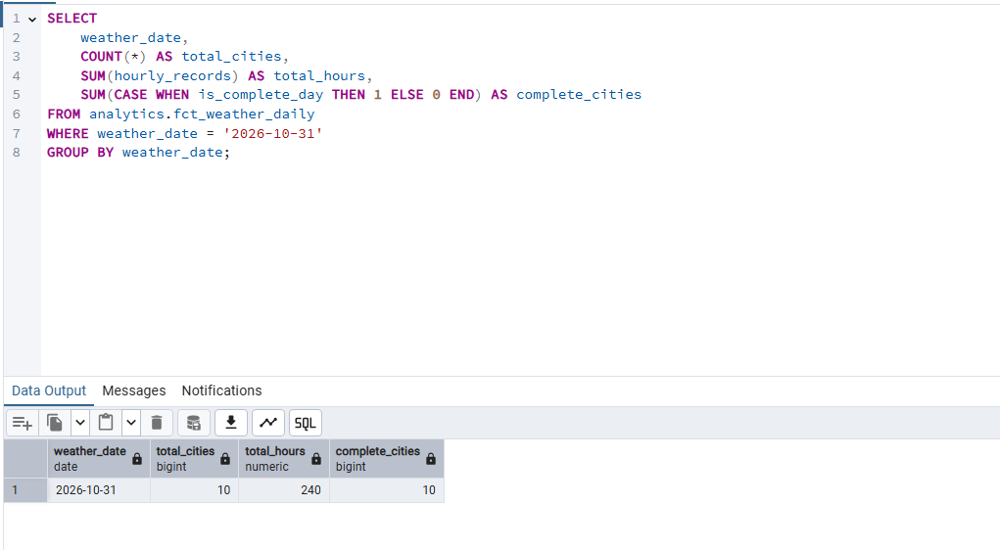

**Automatic PostgreSQL initialization**

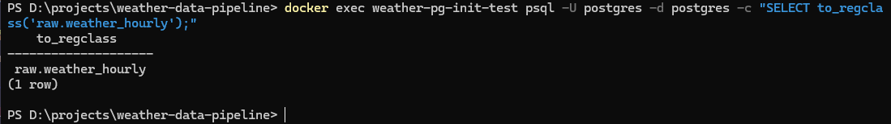


## Resilience, Error Handling and Data Quality

### Overview

This phase improves pipeline reliability through automatic retries, HTTP error handling, data quality validation, and automated Python tests.

### 1. Airflow Retry Validation

A temporary DAG named `resilience_test` was created to simulate controlled task failures.

The task was configured with:

- 2 automatic retries.
- A 20-second retry delay.
- A command that intentionally returns exit code 1.

Airflow successfully performed three attempts before marking the task as failed.

This confirmed that task failures are detected and retries are executed automatically.

The temporary DAG was removed after testing.

### 2. API Error Handling

The Python extraction script was improved to handle API failures.

Both `get_city_coordinates()` and `fetch_weather()` now use exception handling to detect HTTP and network errors.

When an API request fails, the script raises a descriptive exception containing the affected city and, where applicable, the processing date.

The original exception is preserved to support troubleshooting.

Errors are propagated to Airflow so that task retries can be applied.

### 3. Weather Data Quality Validation

Additional validation was implemented in `fetch_weather()`.

The extraction now checks that:

- The API response contains hourly weather data.
- Each processed UTC day contains exactly 24 hourly timestamps.
- All four weather variables contain 24 values.
- No weather variable contains missing (`None`) values.

Invalid data causes the extraction to fail before the affected city's JSON file is saved or uploaded to S3.

### 4. Automated Python Tests

Four automated unit tests were implemented using Python's built-in `unittest` framework and mocked API responses.

| Test | Purpose | Result |
|---|---|---|
| Weather API timeout | Verify request failure handling | Passed |
| Geocoding API timeout | Verify coordinate request failure handling | Passed |
| Incomplete hourly data | Reject responses containing fewer than 24 hours | Passed |
| Missing weather values | Reject incomplete weather measurements | Passed |

Run the tests using:

`docker compose exec airflow python /opt/airflow/scripts/test_error_handling.py`

All four tests passed successfully.

### 5. Final Pipeline Validation

After implementing the improvements, the main `weather_pipeline` DAG was executed again.

All four Airflow tasks completed successfully:

- `extract_weather`
- `load_weather`
- `dbt_run`
- `dbt_test`

This confirmed that the new validations did not break the existing pipeline.

### 6. Evidence

**Airflow automatic retries**

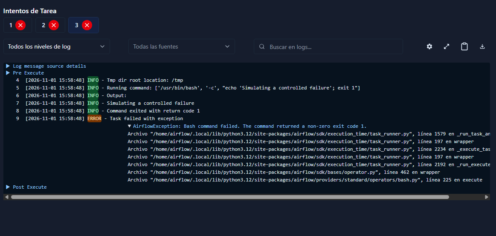

**Automated Python tests**

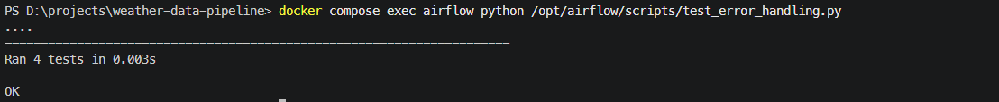

### 7. Known Limitations

- Retries are managed by Airflow, but automated notifications have not been configured.
- The Python tests cover selected error scenarios rather than every possible API or infrastructure failure.
- The pipeline does not yet have centralized monitoring or production-grade alerting.

### Conclusion

Phase 8 improved the reliability of the weather data pipeline by introducing explicit error handling, automated testing, input data validation, and verified task retry behavior.