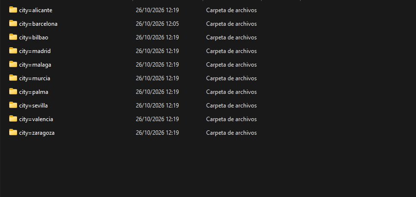
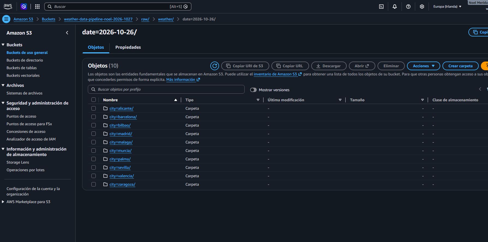
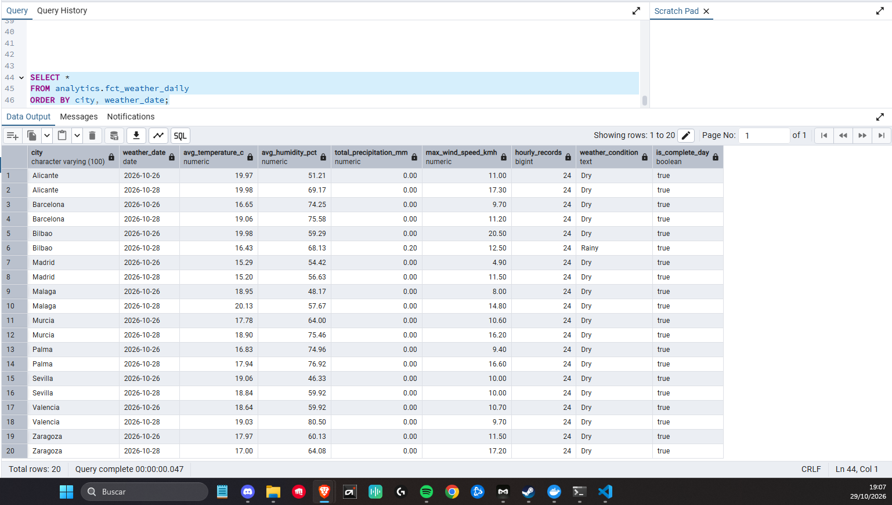
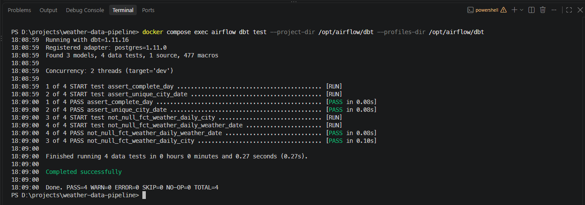

# Weather Data Pipeline

A small end-to-end Data Engineering project built with:

- Python
- PostgreSQL
- dbt
- Apache Airflow
- Docker
- AWS S3

The entire pipeline runtime is containerized with Docker Compose.

> Work in progress.

## Local architecture

The project uses Docker Compose to provide a reproducible local environment.

The host machine only requires Docker Desktop, Git, VS Code and the AWS CLI.

Docker Compose currently runs:

- PostgreSQL 17 for data storage and Airflow metadata.
- A custom Apache Airflow 3.3.2 image based on Python 3.12.
- dbt Core and dbt-postgres inside the Airflow image.

Pipeline dependencies such as requests, boto3 and the PostgreSQL Python driver are installed inside the Airflow image rather than on the host machine.


## Data ingestion

Weather data is extracted from the Open-Meteo API using Python and the `requests` library.

The pipeline currently processes the following Spanish cities:

- Barcelona
- Madrid
- Valencia
- Sevilla
- Bilbao
- Malaga
- Zaragoza
- Murcia
- Palma
- Alicante

City coordinates are resolved dynamically using the Open-Meteo Geocoding API. This avoids hardcoding latitude and longitude values in the project and makes it easier to add new cities later.

The ingestion process follows this flow:

```text
City name
    ↓
Open-Meteo Geocoding API
    ↓
Latitude / Longitude
    ↓
Open-Meteo Weather API
    ↓
Hourly weather data
    ↓
Raw JSON
```

### Weather variables

For each city, the pipeline retrieves the following hourly variables:

- Temperature at 2 metres
- Relative humidity at 2 metres
- Precipitation
- Wind speed at 10 metres

The pipeline retrieves data for the previous complete day.

All timestamps are requested in UTC to keep the time representation consistent across the pipeline and avoid issues related to local time zones or daylight-saving changes.

### Raw data storage

The raw API response is preserved as JSON before any transformation is applied.

Files are stored using a date and city partition structure:

```text
data/
└── raw/
    └── weather/
        └── date=YYYY-MM-DD/
            ├── city=barcelona/
            │   └── weather.json
            ├── city=madrid/
            │   └── weather.json
            ├── city=valencia/
            │   └── weather.json
            └── ...
```

For example:

```text
data/raw/weather/date=2026-10-25/city=barcelona/weather.json
```

The `data/raw/` directory is excluded from Git because these files are generated by pipeline executions rather than being part of the source code.

### Why keep raw data?

Keeping the original API response allows the pipeline to reprocess data later without calling the source API again.

This also separates ingestion from downstream transformation logic:

```text
Source API
    ↓
Raw data
    ↓
Transformation
    ↓
Analytical data
```

Raw weather data is saved locally and uploaded to Amazon S3 using Boto3.

### Idempotency

The extraction process uses deterministic paths based on the processing date and city.

For example:

```text
date=2026-10-25/city=barcelona/weather.json
```

Running the extraction multiple times for the same date and city overwrites the same file instead of creating duplicates.

This provides a basic form of pipeline idempotency and makes retries safer.

### Error handling

The ingestion script includes basic error handling:

- HTTP requests use a timeout to prevent connections from waiting indefinitely.
- `raise_for_status()` stops execution when an API request returns an HTTP error.
- Geocoding results are validated before coordinates are used.
- Weather responses are checked to ensure hourly data is present.
- Existing output directories can be reused without causing errors.

More advanced retry handling will later be managed by Apache Airflow.

### Running the ingestion

The Python runtime and its dependencies are installed inside the custom Airflow Docker image.

No Python dependencies need to be installed directly on the Windows host.

From the project root:

```text
D:\projects\weather-data-pipeline
```

run:

```powershell
docker compose exec airflow python /opt/airflow/scripts/extract_weather.py
```

The script:

1. Calculates the previous day in UTC.
2. Iterates through the configured cities.
3. Resolves coordinates using the Geocoding API.
4. Retrieves hourly weather data.
5. Creates the corresponding raw directory.
6. Stores the original API response as `weather.json`.

### Verify generated files

From the project root:

```powershell
Get-ChildItem .\data\raw\weather -Recurse -Filter weather.json
```

To count the generated JSON files:

```powershell
(Get-ChildItem .\data\raw\weather -Recurse -Filter weather.json).Count
```

With the current configuration, the expected result is:

```text
10
```

Running the ingestion again for the same date should still return:

```text
10
```

rather than `20`, because the same files are overwritten.

### Current ingestion architecture

```text
                    Open-Meteo
                        │
                        │
              ┌─────────▼──────────┐
              │   Geocoding API    │
              │                    │
              │ City → coordinates │
              └─────────┬──────────┘
                        │
                        ▼
              ┌────────────────────┐
              │    Weather API     │
              │                    │
              │ Hourly weather     │
              └─────────┬──────────┘
                        │
                        ▼
              ┌────────────────────┐
              │       Python       │
              │                    │
              │ extract_weather.py │
              └─────────┬──────────┘
                        │
                        ▼
              ┌────────────────────┐
              │     Raw JSON       │
              │                    │
              │ date + city        │
              └────────────────────┘

All Python code is executed inside the custom Airflow Docker container.
```

### Technical decisions

The main technical decisions made during this phase are:

- **Dynamic geocoding instead of hardcoded coordinates:** city coordinates are retrieved using the Open-Meteo Geocoding API.
- **Configuration-driven cities:** the ingestion logic is reusable and new cities can be added to the `CITIES` list without changing the extraction logic.
- **UTC timestamps:** keeps time handling consistent across the pipeline.
- **Previous complete day:** avoids processing partially completed days.
- **Raw JSON preservation:** keeps the source response available for future reprocessing.
- **Date and city partitioning:** creates a predictable raw-data structure that can later be reproduced in S3.
- **Deterministic filenames:** helps make the extraction idempotent.
- **HTTP timeout:** prevents requests from remaining open indefinitely.
- **Explicit HTTP error handling:** failed API responses stop the pipeline instead of being silently accepted.
- **Docker-first execution:** Python and its dependencies run inside the Airflow image rather than on the host machine.

### Current limitations

At this stage:

- Raw data is stored both locally and in a private Amazon S3 bucket.
- The script is executed manually rather than through an Airflow DAG.
- The raw JSON has not yet been loaded into PostgreSQL.
- No dbt transformations have been created yet.

These components will be added in later phases.

### Data source

Weather and geocoding data are provided by Open-Meteo.


### Example raw data partitions

After running the ingestion pipeline, one directory is created for each configured city:




## AWS S3 Raw Storage

The pipeline now uploads the raw weather JSON files to Amazon S3 after saving them locally.

### AWS authentication

AWS access is configured using a dedicated IAM user:

- `weather-pipeline-dev`
- MFA enabled
- No permanent access keys are stored in the project
- Authentication is performed using `aws login`
- Temporary AWS credentials are reused inside the Airflow container through a bind mount

The AWS configuration is mounted from the Windows host into the Airflow container:

```text
Windows host
~/.aws/config
~/.aws/login
        |
        v
Airflow container
/home/airflow/.aws/
```

This allows Boto3 to authenticate with AWS without storing AWS secrets in `.env` or GitHub.

### S3 bucket

Raw weather data is stored in:

```text
s3://weather-data-pipeline-noel-2026-1027/
```

The bucket is located in:

```text
eu-west-1
```

The bucket remains private and S3 Block Public Access is enabled.

### S3 partition structure

The same partition structure used locally is preserved in S3:

```text
raw/
└── weather/
    └── date=YYYY-MM-DD/
        ├── city=alicante/
        │   └── weather.json
        ├── city=barcelona/
        │   └── weather.json
        ├── city=bilbao/
        │   └── weather.json
        ├── city=madrid/
        │   └── weather.json
        ├── city=malaga/
        │   └── weather.json
        ├── city=murcia/
        │   └── weather.json
        ├── city=palma/
        │   └── weather.json
        ├── city=sevilla/
        │   └── weather.json
        ├── city=valencia/
        │   └── weather.json
        └── city=zaragoza/
            └── weather.json
```

### Upload process

The Python extraction script uses Boto3 to upload each generated JSON file to S3.

The flow is now:

```text
Open-Meteo
    |
    v
Python extraction
    |
    v
Local raw JSON
    |
    v
Boto3
    |
    v
Amazon S3 raw layer
```

The S3 object key is generated dynamically:

```text
raw/weather/date=<date>/city=<city>/weather.json
```

### Idempotency

The pipeline was executed multiple times for the same date.

Each city always uses the same deterministic S3 object key, so running the pipeline again replaces the existing object instead of creating duplicates.

Expected result:

```text
First run  -> 10 objects
Second run -> 10 objects
```

This makes the raw ingestion step idempotent for the same city and date.

### Running the pipeline

```powershell
docker compose exec airflow python /opt/airflow/scripts/extract_weather.py
```

### Verify S3 objects

```powershell
aws s3 ls s3://weather-data-pipeline-noel-2026-1027/raw/weather/date=YYYY-MM-DD/ --recursive --profile weather-pipeline
```

### Screenshot

The S3 raw data partition structure can be seen below:



### Technical decisions

- Amazon S3 is used as the cloud raw storage layer.
- Raw API responses are preserved as JSON.
- Data is partitioned by date and city.
- Boto3 is used for programmatic uploads.
- AWS authentication uses temporary credentials instead of long-lived access keys.
- AWS configuration is mounted into the Airflow container.
- AWS secrets are never stored in the repository.
- The S3 bucket remains private.
- Re-running the extraction for the same date does not create duplicate objects.


## PostgreSQL and dbt Transformations

In this phase, raw weather data stored in Amazon S3 is loaded into PostgreSQL and transformed using dbt Core.

### Data pipeline

```text
Amazon S3 (raw JSON)
        |
        v
Python + Boto3 + psycopg2
        |
        v
PostgreSQL: raw.weather_hourly
        |
        v
dbt Staging: stg_weather_hourly
        |
        v
dbt Intermediate: int_weather_daily
        |
        v
dbt Marts: fct_weather_daily
```

### PostgreSQL ingestion

The `scripts/load_weather.py` script reads raw weather JSON files from S3, converts hourly arrays into database records, and loads them into PostgreSQL.

The raw table uses `(city, observed_at)` as a composite primary key.

Data loading uses `INSERT ... ON CONFLICT DO UPDATE` to prevent duplicate records when the pipeline is executed multiple times.

The initial validation included 480 hourly records across 10 Spanish cities and two dates.

### dbt models

The dbt project is organized into three transformation layers.

| Layer | Model | Purpose |
|---|---|---|
| Staging | `stg_weather_hourly` | Standardizes column names and creates a UTC weather date |
| Intermediate | `int_weather_daily` | Calculates daily weather metrics using SQL aggregations |
| Marts | `fct_weather_daily` | Creates the final analytical table with weather classifications and completeness indicators |

The final mart contains daily temperature, humidity, precipitation, wind speed, and completeness metrics.

The staging and intermediate models use views, while the final mart is materialized as a PostgreSQL table.

### Data quality tests

Four dbt tests were implemented:

- `not_null` on `city`
- `not_null` on `weather_date`
- `assert_unique_city_date` to detect duplicate city/date combinations
- `assert_complete_day` to check for 24 hourly records per city and day

All four tests passed during validation.

### Running the pipeline

First, extract and upload weather data to S3:

```powershell
docker compose exec airflow python /opt/airflow/scripts/extract_weather.py
```

Then load the data into PostgreSQL:

```powershell
docker compose exec airflow python /opt/airflow/scripts/load_weather.py
```

Run all dbt models:

```powershell
docker compose exec airflow dbt run --project-dir /opt/airflow/dbt --profiles-dir /opt/airflow/dbt
```

Run the data quality tests:

```powershell
docker compose exec airflow dbt test --project-dir /opt/airflow/dbt --profiles-dir /opt/airflow/dbt
```

### Validation screenshots

**Final weather mart**



**dbt data quality tests**



### Technical decisions

- PostgreSQL stores hourly weather observations.
- Python and psycopg2 handle the S3-to-PostgreSQL ingestion.
- Upserts prevent duplicate city/hour combinations.
- dbt separates transformations into reusable SQL models.
- `source()` references the original PostgreSQL table.
- `ref()` defines dependencies between dbt models.
- The final mart is materialized as a table for analytical consumption.
- Data quality tests validate essential business rules.

Pipeline orchestration will be implemented using Apache Airflow.

> Work in progress.